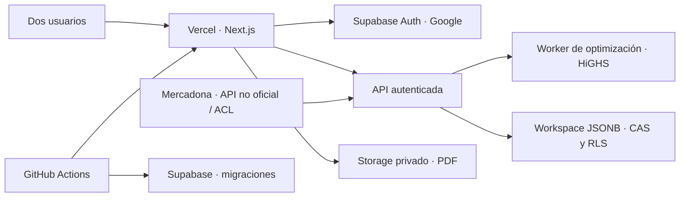

# Mesa


Planificador quincenal para dos personas, con recetas, objetivos nutricionales y lista de compra. La aplicación utiliza Supabase Auth y un espacio de datos privado compartido; requiere configurar Supabase y Google antes de poder iniciar sesión.

## Contexto: el problema de la dieta de Stigler

La dieta de Stigler es un problema clásico de investigación operativa: elegir cantidades de alimentos para minimizar el coste sin dejar de satisfacer unos requisitos nutricionales. George Stigler publicó su análisis en 1945 usando precios y una lista histórica de alimentos; la formulación se convirtió en un ejemplo de programación lineal. [Google OR-Tools describe el modelo clásico](https://developers.google.com/optimization/lp/stigler_diet) y una revisión académica explica su contexto y sus límites como modelo de dieta ([Masset et al., 2018](https://pmc.ncbi.nlm.nih.gov/articles/PMC6021504/)).

Mesa adapta esa idea a un problema de planificación y no reproduce el menú histórico. Aplica los objetivos acordados para los perfiles y selecciona recetas aprobadas por el profesional que asesora el proyecto, calculando porciones para dos personas durante 14 días y envases enteros que cubran sus ingredientes. Los objetivos, precios y valores nutricionales dependen de los datos introducidos; los datos sintéticos solo sirven para demostraciones.

## Cómo optimiza Mesa

El modelo entero mixto minimiza un coste compuesto por envases, sobrantes estimados, existencias que podrían caducar, sodio, repetición de recetas y una pequeña preferencia por la valoración de cada receta. Sujeto a ello, exige para cada persona y cada día calorías, proteínas, carbohidratos y grasas dentro de ±10 % de sus objetivos; cumple límites nutricionales activos, fija las recetas que se hayan bloqueado y puede imponer máximos de repetición y mínimos semanales por grupos. Las raciones se representan en incrementos de media ración; las compras son números enteros de envases.

Para acotar el cálculo, primero busca con una selección rotatoria de hasta tres recetas candidatas por franja y día (incluidas las dos de mayor energía); si esa reducción resulta inviable, repite con todas las recetas. La solución se verifica antes de aceptarla. Una solución factible encontrada al alcanzar el límite de tiempo no equivale a demostrar que sea el óptimo global.

El modelo necesita sodio conocido para las recetas de cada franja; si se activa un objetivo de otros nutrientes, exige esos valores también. La aplicación no infiere automáticamente la composición nutricional a partir del catálogo de Mercadona: precio y tamaño del envase no bastan para calcular los nutrientes de cada ingrediente. Por eso los nutrientes se registran por receta y ración, y los desconocidos no se tratan como cero. Consulta la [formulación matemática y las limitaciones](docs/optimizacion.md) antes de interpretar un resultado.

## Arquitectura



La aplicación separa autenticación, validación de peticiones, optimización y persistencia. Supabase guarda un workspace JSON versionado por hogar, con escrituras atómicas de comparación e incremento de revisión; los PDFs van a un bucket privado con políticas por miembro. La consulta Mercadona está detrás de una capa de integración para poder sustituir el proveedor. Vercel aloja la aplicación y GitHub Actions valida cambios y aplica las migraciones de Supabase tras los controles de CI. La arquitectura detallada, los límites de confianza y los flujos están en [docs/arquitectura.md](docs/arquitectura.md).

La arquitectura y las decisiones del modelo también se resumen en el [índice visual del repositorio](.agent-native/visual-docs/repo-overview/plan.mdx).

## Inicio

```sh
cp .env.example .env.local
npm ci
npm run dev
```

Abrir http://localhost:3000. Añadir dos perfiles con objetivos revisados, productos y al menos una receta para cada una de las cuatro comidas. Los valores de una receta son por ración y las cantidades de ingredientes usan las unidades de sus productos. El optimizador exige nutrientes diarios dentro del 10% de cada objetivo y compra envases enteros; tiene en cuenta existencias, preferencia y sodio por ración verificado por el usuario, pero no garantiza variedad, límites de sodio ni valida alergias. Las recetas sin sodio no participan en la optimización; se necesita al menos una receta con sodio por cada franja. Si se registran restricciones, bloquea la optimización.

Requisitos: Node.js 22.13 o posterior y npm. Para ejecutar la suite y los controles locales antes de proponer cambios:

```sh
npm test
npm run test:coverage
npm run check:crap
npm run check:migrations
npm run build
```

## Documentación del proyecto

- [Arquitectura, seguridad, persistencia y diagramas](docs/arquitectura.md)
- [Problema de Stigler, formulación del MILP y limitaciones](docs/optimizacion.md)
- [Operaciones de terminal, credenciales, despliegue y migraciones](docs/operaciones-terminal.md)
- [Controles de CI y migración de base de datos](CI.md)
- [Índice visual del repositorio](.agent-native/visual-docs/repo-overview/plan.mdx)

La estimación de mantenimiento usa Mifflin-St Jeor y el factor de actividad seleccionado. La pantalla recomienda objetivos iniciales conforme a los parámetros del proyecto, presenta el cálculo y deja que cada persona confirme o ajuste la propuesta; nunca sobrescribe objetivos ya confirmados. Con datos completos, IMC desde 25 y una propuesta de al menos 1.200 kcal/día, el déficit inicial configurado es del 10 %, con un reparto energético 20 % proteína, 50 % carbohidratos y 30 % grasa. La comprobación de macros es una verificación matemática aproximada del reparto energético.

## Pendiente antes de uso real

Quedan pendientes la sincronización sin conexión, la extracción estructurada de recetas, la búsqueda por nombre y actualización automática del catálogo de Mercadona, y la incorporación de fuentes nutricionales verificadas. La consulta individual utiliza la API no oficial de Mercadona para 08191. Las recetas con valores sintéticos son datos de demostración.

## Importación de PDF

En Recetas se selecciona un PDF local de hasta 20 MiB. El navegador extrae el texto y ejecuta OCR en español en las páginas con poco texto. El original se conserva en el bucket privado `household-documents` y puede reabrirse después desde una sesión del hogar; cada página se conserva como borrador para su revisión. Los borradores compartidos tienen un límite de 3 MiB para mantener las solicitudes dentro del tamaño admitido por el despliegue. Si el OCR produce demasiados datos, la importación se rechaza antes de subir el original. Las sugerencias de ingredientes y nutrientes pueden ser incompletas; se confirman durante la revisión.

## Estados y biblioteca

Cada PDF se agrupa como una importación independiente. Sus páginas pueden estar pendientes, en revisión, revisadas o descartadas. Guarda todas las recetas de una página antes de marcarla revisada; marca índices u otras páginas que no sean recetas como descartadas. Cuando todas las páginas están resueltas, la biblioteca permite aprobar el archivo expresamente. Al reabrir una página se revoca la aprobación del archivo. Los borradores anteriores que no tenían identificador de importación se agrupan por nombre y se consideran pendientes; las recetas antiguas permanecen aprobadas sin asignarles una página automáticamente. La biblioteca permite filtrar recetas aprobadas y páginas por estado.

## Revisión del menú

El menú muestra un resumen diario por persona calculado con las raciones y los nutrientes introducidos. Se puede fijar o cambiar una receta para una franja y recalcular. Los cambios de perfiles, recetas o productos invalidan la confirmación hasta que se recalcule; los planes antiguos sin huella de datos también requieren un nuevo cálculo. La tolerancia del 10 % y los datos manuales son limitaciones del prototipo.

## Sodio

Registra los miligramos de sodio por ración, incluyendo la sal añadida y todos los ingredientes. Un dato ausente no es cero; se excluye del cálculo hasta revisarlo. Una cifra real de cero es válida. El objetivo combinado suma 0,10 € de penalización por cada 1.000 mg de sodio de las raciones planificadas, además del coste y preferencias. Esta ponderación es una decisión del prototipo; puede seleccionar más sodio si reduce otros costes y no impone un máximo diario. El resumen diario solo cubre las recetas planificadas. La OMS recomienda en adultos menos de 2.000 mg de sodio por día; 1 g de sal equivale aproximadamente a 400 mg de sodio.

## Vitamina D

Cada perfil permite guardar una referencia opcional (µg/día), incluida la ingesta adecuada de referencia de EFSA para adultos sanos suponiendo síntesis cutánea mínima: 15 µg/día. Cada receta admite un contenido opcional de vitamina D por ración y su fuente; el resumen diario suma solo las comidas conocidas e indica la cobertura. El cálculo refleja únicamente las comidas registradas en el menú. Solo influye en el optimizador si se activa explícitamente un mínimo diario independiente de la referencia informativa. EFSA: https://www.efsa.europa.eu/en/press/news/161028; NHS: https://www.nhs.uk/live-well/bone-health/food-for-strong-bones/

## Límites y aprovechamiento del optimizador

En cada perfil se pueden activar límites diarios estrictos de fibra, grasas saturadas, azúcares libres, calcio y vitamina D. Se introducen y ajustan de acuerdo con los objetivos definidos para el perfil. Al activar un límite, solo se consideran recetas que tengan ese dato por ración; el dato desconocido nunca equivale a cero. Los azúcares libres no son lo mismo que el total de azúcares de una etiqueta.

En cada receta se pueden revisar estos valores, su fuente y los grupos que contiene. En Menú se puede fijar un máximo de apariciones de cada receta durante los 14 días y mínimos semanales de platos por grupo. Son restricciones estrictas opcionales; una clasificación puede pertenecer a varios grupos y el recuento no garantiza cantidad mínima de alimentos. El modelo penaliza cada repetición adicional en 0,75 unidades equivalentes a euros del objetivo, junto con coste, sodio y valoración. Para acotar el tiempo se explora primero una selección rotatoria de recetas; el resultado no garantiza el óptimo global de todas las combinaciones posibles.

Si una existencia tiene fecha de caducidad, hay que indicar el inicio del plan. El modelo no la utiliza después de su fecha; los productos comprados se suponen disponibles toda la quincena porque no se conoce su conservación. Se calcula sobrante y posible caducidad de existencias suponiendo que se consumen primero. El objetivo añade penalizaciones equivalentes al 5 % del valor estimado del sobrante y al 20 % del valor estimado de existencias no usadas antes de caducar. Son ponderaciones del prototipo, no costes monetarios reales; pueden entrar en conflicto con precio, sodio o preferencias. El usuario debe revisar los resultados y las condiciones de conservación.

## Almacenamiento y migración

Se requiere Node.js 22.13 o posterior. Configura en `.env.local` las variables de `.env.example`: URL y clave publicable de Supabase, exactamente dos correos autorizados y el identificador del hogar. En Supabase Auth configura Google como único método de acceso y desactiva email/contraseña, teléfono y otros proveedores; el servidor también exige identidad Google con correo verificado, además de la allowlist. Registra la ruta `/auth/callback`, crea la membresía de las dos cuentas en el hogar y aplica las migraciones antes de arrancar. Los secretos y los datos personales se mantienen fuera de Git.

El workspace se guarda en Supabase con control de revisión para detectar ediciones simultáneas. Un hogar sin datos queda en estado pendiente de importación; las cuentas autorizadas no pueden crear el primer workspace. El administrador debe sembrar o migrar el estado mediante el script administrativo. La app conserva y permite descargar la copia del navegador mientras espera esa migración. Los navegadores consultan los cambios aproximadamente cada cuatro segundos cuando no hay ediciones pendientes. El adaptador local SQLite y el script de migración se conservan para trasladar instalaciones anteriores.

El botón **Descargar copia** exporta el estado como JSON sin cifrar: guardar el archivo en un lugar seguro. Para una copia física consistente de SQLite usa la API de copia de SQLite; no copies solo el archivo principal mientras la aplicación esté escribiendo, porque puede haber archivos WAL. La importación de copias JSON aún no está implementada.

`lib/storage/contract.ts` define el contrato de lectura y escritura con comparación de revisión atómica. Las migraciones SQL y políticas de aislamiento de hogares están en `supabase/`. El script `scripts/migrate-sqlite-to-supabase.mjs` hace una simulación por defecto y requiere `MESA_LEGACY_DB_PATH`; para importar necesita además credenciales administrativas configuradas fuera del repositorio.
