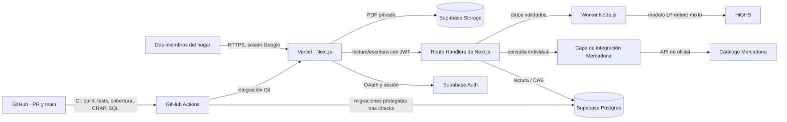
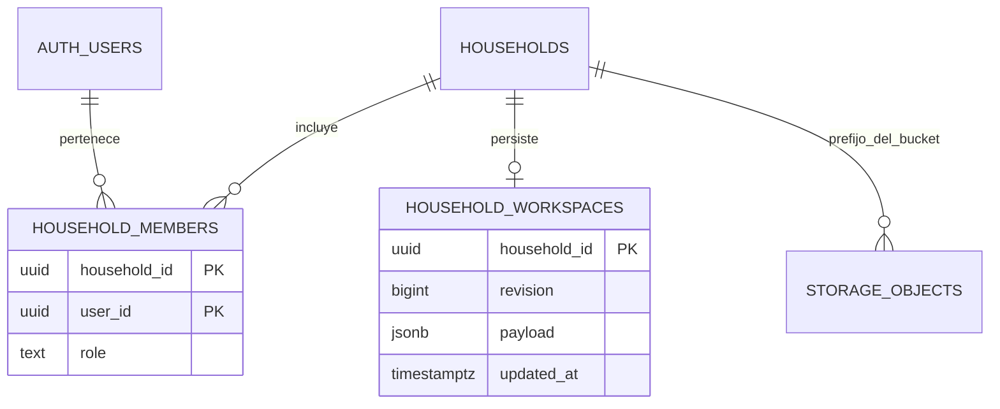

# Arquitectura de Mesa

Este documento describe la arquitectura que existe en el repositorio. Las vistas de despliegue son el diseño previsto; producción debe configurarse con los valores de entorno y proyectos correctos antes de darse por operativa.

## Vista de contexto



## Componentes y responsabilidades

| Área | Implementación | Responsabilidad |
| --- | --- | --- |
| Interfaz | Next.js App Router, React | Perfiles, recetas, despensa, menú quincenal y lista compartida. |
| Sesión | Supabase Auth con Google | Intercambiar el código OAuth y mantener sesión en cookies. |
| Autorización | `proxy.ts`, `lib/supabase/authorization.ts` y servidor | Exigir sesión, correo verificado y allowlist; las rutas vuelven a comprobar autorización. |
| APIs | `app/api/*/route.ts` | Validar entrada, tamaño, origen y acceso antes de consultar datos o resolver el modelo. |
| Optimización | `lib/optimizer.cjs`, `lib/optimizer-worker.mjs` | Construir el MILP, resolverlo con HiGHS y verificar el resultado en un worker con tiempo limitado. |
| Catálogo | `lib/mercadona.cjs` y `/api/mercadona` | Encapsular la integración no oficial; los campos disponibles no sustituyen valores nutricionales. |
| Estado del hogar | `lib/storage/supabase.ts` y `/api/workspace` | Guardar el payload JSONB de un hogar y comparar revisiones para evitar sobrescrituras concurrentes. |
| Documentos | Supabase Storage `household-documents` | Mantener PDFs privados en carpetas identificadas por hogar, con autorización RLS. |
| CI/CD | `.github/workflows/ci.yml`, Vercel | Validar pull requests y aplicar migraciones remotas en `main` después de las comprobaciones requeridas. |

## Lectura y escritura compartida

```mermaid
sequenceDiagram
  participant B as Navegador
  participant N as Next.js API
  participant S as Supabase Auth
  participant P as Postgres / RPC
  B->>N: GET /api/workspace (cookie de sesión)
  N->>S: Validar usuario Google autorizado
  N->>P: Leer fila del household_id bajo RLS
  P-->>N: payload JSONB + revision
  N-->>B: estado + revision (no-store)
  Note over B: El cliente guarda cambios con expectedRevision
  B->>N: PUT /api/workspace
  N->>S: Validar sesión y origen
  N->>P: write_household_workspace(expectedRevision, payload)
  P->>P: Verificar membresía y comparar revisión
  alt La revisión coincide
    P-->>N: ok=true, revision+1
    N-->>B: guardado
  else Otra pestaña/dispositivo escribió antes
    P-->>N: ok=false y revisión actual
    N-->>B: 409 conflicto; no sobrescribir
  end
```

El cliente actualiza el workspace de otros dispositivos mediante consulta periódica cada cuatro segundos cuando no hay escrituras o ediciones locales pendientes. No hay canal WebSocket/Realtime implementado. La importación inicial no la crea un usuario desde el navegador: se reserva al proceso administrativo de migración.

## Modelo persistente



El catálogo de recetas, perfiles, productos, planes y compras se serializa actualmente dentro de `household_workspaces.payload`; no hay una tabla relacional por receta o producto. Esta elección simplifica la edición atómica del pequeño estado familiar, a costa de no ofrecer consultas SQL detalladas por entidad. SQLite permanece como adaptador local/legado para instalaciones previas; el adaptador de la ruta de aplicación actual es Supabase.

## Límites de confianza

- El cliente usa la clave publicable de Supabase; las políticas RLS deben mantenerse habilitadas y el servidor usa el JWT de la sesión. No se incluye una service-role key en el navegador.
- El acceso tiene dos capas: autorización de aplicación (Google, correo verificado y allowlist) y membresía/RLS en base de datos y Storage.
- El estado compartido no se devuelve desde caché pública; las escrituras incluyen revisión esperada y tienen límite de tamaño.
- La API de Mercadona es no oficial y puede cambiar o no devolver precio, disponibilidad o composición nutricional completos.
- Los PDFs se procesan en el dispositivo; OCR y sugerencias requieren revisión humana. No se acepta el resultado del OCR como receta aprobada automáticamente.
- Vercel y Supabase son servicios de despliegue separados. La integración Git despliega la app; GitHub Actions aplica migraciones después de build, pruebas, cobertura, CRAP y migraciones locales.

## Documentación relacionada

- [Modelo de programación lineal](optimizacion.md)
- [Operaciones de terminal, CI y secretos](operaciones-terminal.md)
- [Migración SQLite → Supabase](../scripts/migrate-sqlite-to-supabase.mjs)
- [Migración y políticas de Supabase](../supabase/migrations/202611080001_private_household_storage.sql)
- [Pipeline de CI y migración remota](../.github/workflows/ci.yml)
