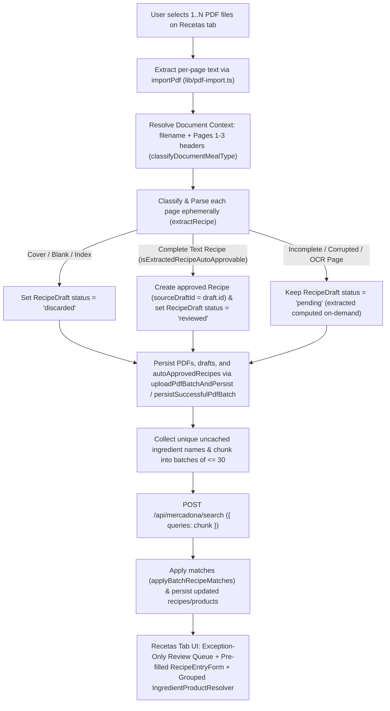

# Automated Recipe Extraction and Exception-Only PDF Import UX

*   **Author:** Anyul Rivas
*   **Status:** Reviewed
*   **Date:** 2026-11-12

--------------------------------------------------------------------------------

## Overview

Compra Saludable allows households to import recipe PDFs in the browser, extract recipes with per-serving nutritional macros and ingredients, match those ingredients against the Mercadona catalog, and generate a 14-day optimized meal and shopping plan.

Currently, importing PDF files via [lib/pdf-import.ts](../../lib/pdf-import.ts) and [lib/pdf-upload-workflow.ts](../../lib/pdf-upload-workflow.ts) only stores raw page text as unparsed drafts (`RecipeDraft`) with `status: "pending"`. Turning those pages into usable recipes requires clicking each page one by one on the `Recetas` tab ([app/dashboard.tsx](../../app/dashboard.tsx)), clicking buttons in [components/RecipeSuggestions.tsx](../../components/RecipeSuggestions.tsx) to copy each suggested macro, typing every ingredient name, quantity, and unit by hand in [components/RecipeEntryForm.tsx](../../components/RecipeEntryForm.tsx), selecting the meal category (`Desayuno`, `Comida`, `Cena`, or `Tentempié`), checking a confirmation box (`reviewConfirmed`), and saving each recipe individually.

An empirical analysis of two 200-recipe PDFs (`200 Cenas Antinflamatorias`, 203 pages; and `200 Comidas Antinflamatorias`, 206 pages; 409 pages total) reveals consistent structural patterns across all recipes as well as specific PDF extraction failure modes that the current parser in [lib/recipe-extraction.mjs](../../lib/recipe-extraction.mjs) cannot handle.

This design replaces manual page-by-page data entry with an automated extraction, normalization, and classification pipeline during PDF import:

1.  **Document-Aware Meal Classification**: Detect the `Meal` category (`Desayuno`, `Comida`, `Cena`, `Tentempié`) at the document level using filename tokens, cover page titles (page 1), and index headings (pages 2–3, e.g., `IDEAS DE RECETAS PARA CENAS`), propagating the detected meal type across all recipe pages in that document before falling back to page-level text signals.
2.  **Multi-Line & Interleaved Layout Parser**: Reconstruct multi-line uppercase titles, strip interleaved watermarks (`RECETAS` / `SIGLO XXI`), domains (`recetassigloxxi.com`, `recetassaludablesdehoy.com`), vertically split page numbers (`10\n0\n149`), and misplaced `ADVERTENCIA` blocks, and handle pages where `INFORMACIÓN NUTRICIONAL:` is pushed to the bottom of the text stream.
3.  **Servings-Normalized Ingredient & Macro Extraction**: Parse per-serving nutritional values (`Calorías`, `Carbohidratos`, `Proteínas`, `Grasas` / `Grasas saludables`, `Fibra`, `Azúcares`, `Sodio`), normalize source typos, detect batch servings headers (`INGREDIENTES (2 raciones)`, `(3-4 raciones)`, `(4 Raciones)`), and divide batch ingredient quantities by the serving count so `Recipe.ingredients` stores per-serving quantities matching the per-serving macros.
4.  **Immediate Auto-Approval & Chunked Post-Persistence Mercadona Lookup**: Automatically discard cover and index pages (`status: "discarded"`), auto-approve complete text-extracted recipes (`approved: true`, draft `status: "reviewed"`), persist the imported batch first, and then resolve unique uncached ingredient names across the batch in chunked requests (`<= 30` queries per call) to `/api/mercadona/search`, leaving only incomplete, OCR-extracted, or source-corrupted pages in an exception queue with a pre-filled editor.

## The Problem

Importing multi-page recipe books such as `200 Cenas Antinflamatorias` (203 pages) and `200 Comidas Antinflamatorias` (206 pages) exposes both UX bottlenecks and concrete parser defects in [lib/recipe-extraction.mjs](../../lib/recipe-extraction.mjs), [lib/recipe-workflow.mjs](../../lib/recipe-workflow.mjs), and [app/dashboard.tsx](../../app/dashboard.tsx):

*   **Manual transcription of 400+ pages**: Clicking "Revisar" (`reviewDraft`) in [app/dashboard.tsx](../../app/dashboard.tsx#L251-L256) resets the recipe state (`recipe`) to empty defaults (`name: ""`, `meal: "Comida"`, `calories: 0`, `ingredients: []`), forcing the user to click suggestion buttons and manually type every ingredient row.
*   **Index pages misidentified as recipes**: On page 2 of `200 Cenas`, `IDEAS DE RECETAS PARA CENAS` is matched as a recipe title and the numbered index entries (`1. Salmón al Horno...`) are matched as preparation steps instead of discarding pages 1–3 as cover/index pages.
*   **Truncated multi-line titles**: `findTitleLine` only takes the first uppercase line, truncating wrapped titles like `"ESPIRAL DE CALABACÍN CON PESTO Y TOMATE\nCHERRY"` (Cenas page 5, Recipe 2) or `"ALBÓNDIGAS DE PAVO EN SALSA DE TOMATE SIN\nAZÚCAR + “ESPAGUETIS” DE CALABACÍN"` (Comidas page 166, Recipe 160).
*   **Dropped wrapped ingredient lines and unparsed units**: `isIngredientLine` requires a digit or vulgar fraction on every line, dropping wrapped continuation lines (`"escurridos"`, `"sin azúcar"`) and returning raw strings instead of structured `{ name, amount, unit }` objects. It also fails on parenthesized weights (`1 taza (150 g)`, `½ aguacate (≈75 g)`, `2 cdas (30 ml)`), ranges (`350–400 g`, `5–6 huevos`), abbreviations (`cda`, `cdas`, `cdta`, `cdita`, `AOVE`), and unquantified staples (`AOVE, sal, pimienta`, `Rúcula (o mezcla de hojas)`).
*   **Unscaled multi-serving ingredient batches**: From Cenas page 116 (Recipe 101) and Comidas page 155 (Recipe 151) onward, ingredients are listed for `2 raciones`, `3-4 raciones`, or `4 raciones` while macros are stated per single serving (`Por ración aprox.`). Storing raw batch amounts without dividing by servings inflates shopping list quantities by 2x–4x.
*   **Nutrition parser blind spots**:
    *   Misses `Grasas saludables: 10 g` on Cenas page 17 (Recipe 14).
    *   Ignores `Fibra: X g` (`fiberG`) and `Azúcares: X g` (`freeSugarG`) even though `Recipe` ([lib/types.ts](../../lib/types.ts#L74-L76)) and [components/NutritionExtras.tsx](../../components/NutritionExtras.tsx) already support both fields.
    *   Fails on English number words present in the PDF text (`Proteínas: thirty g` on Comidas pages 42, 84, and 88 [Recipes 38, 78, 82]; `Carbohidratos: Fifty g` on Comidas page 116 [Recipe 110]).
    *   Fails when `Calorías` is omitted but `Carbohidratos`, `Proteínas`, and `Grasas` are present on Cenas page 13 (Recipe 10: `Carbohidratos: 8 g`, `Proteínas: 26 g`, `Grasas: 8 g`).
    *   Marks macros as `ambiguous` when the PDF layout duplicates the exact same nutrition block in the ingredients column on Comidas pages 128 and 152 (Recipes 122 and 146).
*   **Ignored document-level meal context**: Individual recipe pages rarely repeat the word `"cena"` or `"comida"`, and Cenas pages 4–66 contain a footer disclaimer typo `"¡Disfruta de estos deliciosos postres!"`, so meal type must be determined from the filename and document cover/index headers first.
*   **Per-recipe Mercadona disambiguation bottleneck**: [components/IngredientProductResolver.tsx](../../components/IngredientProductResolver.tsx) and `updateChosenIngredient` ([lib/dashboard-state.mjs](../../lib/dashboard-state.mjs#L24-L46)) resolve one `(recipe.id, ingredientIndex)` slot at a time, which would require hundreds of repetitive clicks for shared staples across 398 auto-approved recipes.

## Goals

*   **Auto-discard cover and index pages**: Detect and mark cover pages and index/table-of-contents pages (`ÍNDICE`, `IDEAS DE RECETAS`, or pages `<= 3` with `>= 10` numbered list lines and no nutrition block) as `discarded` automatically on import.
*   **Document-first, type-safe meal classification**: Determine `Meal` (`Desayuno`, `Comida`, `Cena`, `Tentempié`) using a priority cascade: (1) filename keywords (`cena`, `comida`, `almuerzo`, `desayuno`, `snack`, `tentempie`, `merienda`), (2) document cover/index headings on pages 1–3 (`200 CENAS`, `200 COMIDAS`), and (3) page-level text signals, ignoring boilerplate footer disclaimers.
*   **Complete nutrition extraction with fallback recovery**:
    *   Extract `calories`, `protein`, `carbs`, `fat` (including `Grasas saludables`), `fiberG` (`Fibra`), `freeSugarG` (`Azúcares`), and `sodiumMg` (`Sodio`). Leave omitted optional nutrients (`fiberG`, `freeSugarG`) as `undefined` (never `0`) to respect the clinical safety invariant in [lib/optimizer.cjs](../../lib/optimizer.cjs#L238-L240), and populate a baseline `sodiumMg` when omitted in the PDF so auto-approved recipes satisfy `isNutritionallyComplete`.
    *   Normalize English number words (`thirty` -> `30`, `fifty` -> `50`) and missing units (`Azúcares: 12` -> `12 g`).
    *   Deduplicate repeated macro matches on the same page when their numeric values are identical.
    *   Compute `calories` via the Atwater formula ($4 \times \text{protein} + 4 \times \text{carbs} + 9 \times \text{fat}$) when `protein`, `carbs`, and `fat` are all present and non-negative (with positive sum) but the `Calorías` line was omitted.
*   **Structured Spanish ingredient parser with serving normalization**:
    *   Join multi-line ingredient bullets before parsing, stripping interleaved `ADVERTENCIA`, watermark, and page-number lines.
    *   Detect batch serving counts from `INGREDIENTES (N raciones)` headers and divide ingredient amounts by `servings` to produce per-serving quantities in `"g" | "ml" | "unidades"`.
    *   Prefer explicit metric weights/volumes in parentheses (`1 taza (150 g)` -> `150 g`, `2 cdas (30 ml)` -> `30 ml`, `½ aguacate (≈75 g)` -> `75 g`).
    *   Convert household measures (`cda`/`cucharada` -> `15 ml` liquid or `10 g` solid, `cdta`/`cdita`/`cucharadita` -> `5 ml` or `5 g`, `taza` -> `240 ml` liquid / `30 g` leafy greens / `150 g` other solids, `kg` -> `1000 g`, `litro` -> `1000 ml`), vulgar/slash fractions (`½`, `1/2`, `¼`, `1/4`), and numeric ranges (`350–400 g` -> midpoint `375 g`, `5–6 huevos` -> `5.5 unidades`).
    *   Separate pure seasonings/garnishes/water/utensils (`Sal y pimienta`, `Agua hasta cubrir`, `Brochetas de madera`, `(Opcional)...`) into `Recipe.notes`, expand `AOVE` to `aceite de oliva virgen extra`, preserve product-defining qualifiers (`rallado`, `cocido`, `en polvo`, `molido`), and assign canonical per-serving quantities to known unquantified core staples while routing unknown unquantified lines to `unparsedIngredients`.
*   **Immediate auto-approval, post-persistence chunked Mercadona lookup, and canonical product resolution**:
    *   Convert complete text-extracted recipes (`draft.method === "text"`) into `approved: true` recipes during PDF upload, mark their source pages `reviewed`, and persist the workspace state before running external catalog lookups.
    *   Query unique uncached ingredient names across the batch in chunks of `<= 30` queries against `POST /api/mercadona/search`, and group unresolved ingredients by normalized `(name, unit)` in [components/IngredientProductResolver.tsx](../../components/IngredientProductResolver.tsx) so choosing a Mercadona product once resolves it across all matching recipes.
*   **Exception-only review with pre-filled form**: Route incomplete, OCR-extracted (`draft.method === "ocr"`), or source-corrupted PDF pages (such as Comidas pages 128 and 152 [Recipes 122 and 146]) to an exception queue where clicking `Revisar` pre-fills `recipe` in [app/dashboard.tsx](../../app/dashboard.tsx) with all extracted fields.

## Non-Goals

*   **External LLM or cloud OCR calls**: All parsing, classification, and unit normalization run deterministically in the browser/local runtime without external LLM APIs.
*   **Changing the MILP menu optimizer objective function**: [lib/optimizer.cjs](../../lib/optimizer.cjs) continues to optimize the 14-day meal plan over `State.recipes` (with only `recipeHasPositiveMacros` relaxed to allow `0 g` for individual macros when `calories > 0`).
*   **Removing manual recipe creation or editing**: Users can still create custom recipes or edit auto-approved recipes in `SavedRecipesList` and `IngredientProductResolver`.
*   **Auto-approving per-100g nutrition tables or OCR pages**: Pages stating nutrition per `100 g` / `100 ml` or extracted via OCR (`draft.method === "ocr"`) remain in the exception queue for human confirmation.

## Open Questions

*   None currently open.

## Critical User Journeys (CUJs)

### CUJ 1: Importing `200 Cenas Antinflamatorias.pdf` and `200 Comidas Antinflamatorias.pdf`

*   **Given**: A logged-in household user on the `Recetas` tab selects `200 Cenas Antinflamatorias.pdf` (203 pages) and `200 Comidas Antinflamatorias.pdf` (206 pages).
*   **When**: The upload and text extraction complete.
*   **Then**:
    1.  Pages 1–3 of both files (cover and index pages) are automatically marked `discarded`.
    2.  Meal types are automatically set to `Cena` for all recipes from the first file and `Comida` for all recipes from the second file.
    3.  Complete text-extracted recipes (398 of 400 recipes) are automatically saved into `State.recipes` with `approved: true`, extracted `fiberG` and `freeSugarG` (or `undefined` when omitted), baseline/extracted `sodiumMg`, and per-serving `ingredients`, and their source drafts are marked `reviewed`.
    4.  After persisting the imported PDFs, drafts, and recipes via [lib/pdf-upload-workflow.ts](../../lib/pdf-upload-workflow.ts), unique uncached ingredient names are queried in chunks of `<= 30` via `POST /api/mercadona/search`, and any multi-option ingredients are grouped by `(name, unit)` in [components/IngredientProductResolver.tsx](../../components/IngredientProductResolver.tsx).
    5.  The 2 source-corrupted pages (Comidas pages 128 and 152 [Recipes 122 and 146], where the PDF lacks an ingredient list) remain `pending` in the exception queue.

### CUJ 2: Reviewing a Source-Corrupted Exception Page

*   **Given**: Comidas page 128 (Recipe 122, `CREMA DE BROCOLI Y MANZANA VERDE`) is in the exception queue because the source PDF printed the nutrition table in the `INGREDIENTES` column instead of the ingredients.
*   **When**: The user clicks `Revisar` on that page in `DraftReviewList`.
*   **Then**:
    1.  `recipe` state in [app/dashboard.tsx](../../app/dashboard.tsx) is pre-populated with `name: "CREMA DE BROCOLI Y MANZANA VERDE"`, `meal: "Comida"`, `calories: 240`, `carbs: 18`, `protein: 6`, `fat: 18`, `fiberG: 6`, `freeSugarG: 8`, `sodiumMg`, and the preparation steps in `notes`, with `reviewConfirmed` set to `true`.
    2.  The user only adds the missing ingredient rows (`brócoli`, `manzana verde`, `caldo`) and clicks `Guardar receta`, which saves the recipe and marks the draft `reviewed`.

--------------------------------------------------------------------------------

## Technical Plan (Architecture)

### System Topology & Import Pipeline

The PDF import pipeline runs in the browser during `uploadPdf` ([app/dashboard.tsx](../../app/dashboard.tsx#L170-L204)), delegating PDF.js/OCR text extraction to `importPdf` ([lib/pdf-import.ts](../../lib/pdf-import.ts)), deterministic parsing and classification to [lib/recipe-extraction.mjs](../../lib/recipe-extraction.mjs), state transitions to [lib/recipe-workflow.mjs](../../lib/recipe-workflow.mjs), durable file/workspace storage to [lib/pdf-upload-workflow.ts](../../lib/pdf-upload-workflow.ts), and chunked catalog resolution to [app/api/mercadona/search/route.ts](../../app/api/mercadona/search/route.ts) and [lib/recipe-product-match.mjs](../../lib/recipe-product-match.mjs).



### 1. Document-Level & Page-Level Meal Classifier (`classifyDocumentMealType` & `extractRecipe`)

To prevent footer noise from misclassifying recipes, meal classification runs as a three-tier priority cascade returning `{ meal: Meal, mealSource: "filename" | "document_header" | "page_text" | "default", mealConfidence: "resolved" | "default" | "ambiguous" }`:

```
Priority 1: Document Filename Tokens (classifyDocumentMealType)
  -> Normalize filename (NFD diacritic strip, lowercase, split on non-alphanumeric separators)
  -> Match against Meal Token Table:
     - Cena:      ["cena", "cenas", "dinner", "noche", "nocturno", "nocturna"]
     - Comida:    ["comida", "comidas", "almuerzo", "almuerzos", "lunch", "mediodia"]
     - Desayuno:  ["desayuno", "desayunos", "breakfast", "manana", "matutino"]
     - Tentempié: ["tentempie", "tentempies", "snack", "snacks", "merienda", "meriendas", "picoteo", "postre", "postres"]

Priority 2: Document Cover & Index Headings (Pages 1-3 of same documentId)
  -> Strip ADVERTENCIA disclaimers and domain footers from Pages 1-3
  -> Inspect uppercase heading lines and index titles (e.g. "IDEAS DE RECETAS PARA CENAS", "200 COMIDAS ANTINFLAMATORIAS")
  -> Match against Meal Token Table

Priority 3: Cleaned Page Text Signals (extractRecipe fallback)
  -> Strip ADVERTENCIA disclaimers, watermarks, and CONSEJOS ÚTILES lines from the page text
  -> Match title and section headers against Meal Token Table

Confidence & Fallback Rules:
  -> If the highest matching priority tier matches exactly 1 Meal category:
     return { meal, mealSource, mealConfidence: "resolved" }
  -> If the highest matching priority tier matches >= 2 distinct Meal categories:
     return { meal: "Comida", mealSource, mealConfidence: "ambiguous" }
  -> If no tier matches any token:
     return { meal: "Comida", mealSource: "default", mealConfidence: "default" }
```

### 2. Page Pre-Processing & Cover/Index Auto-Discard (`classifyPageType`)

Before extracting recipe fields, `preprocessPageLines(rawText)` cleans layout artifacts:

1.  **Watermark & Domain Removal**: Strips standalone `RECETAS`, `SIGLO XXI`, `recetassigloxxi.com`, and `recetassaludablesdehoy.com` lines.
2.  **Disclaimer Extraction**: Strips `ADVERTENCIA:` blocks (and trailing page numbers) so mid-page disclaimers (present on Cenas pages 66–165) do not split the `INGREDIENTES` block or trigger false-positive keyword matches.
3.  **Split Page-Number Removal**: Removes trailing standalone page numbers and vertically split 3-digit page numbers at the bottom of the page (`10\n0\n149` on Comidas pages 106–206).

`classifyPageType(cleanedLines, pageNumber, method)` then classifies the page while guarding against silent data loss on OCR-degraded recipe pages:

*   **Cover / Blank Page (`"cover"`)**: `method !== "unreadable"` AND (`cleanedLines` has `< 40` non-whitespace characters with zero numbered steps/quantities, OR `pageNumber <= 3` and the page contains only document title lines without `INGREDIENTES`, `PASO A PASO`, or macro lines).
*   **Index / Table of Contents Page (`"index"`)**: Contains an explicit index heading (`ÍNDICE`, `IDEAS DE RECETAS`, `Índice de recetas`, `Recetas N – M`) OR (`pageNumber <= 5` and contains `>= 10` numbered lines with zero nutritional macro matches and no `INGREDIENTES` header).
*   **Candidate Recipe Page (`"recipe"`)**: All other pages (including `method === "unreadable"` or later pages missing section headers) are classified as `"recipe"` so any incomplete or unreadable page past the front matter routes to the `pending` exception queue rather than being silently discarded.

### 3. Multi-Line Title & Out-of-Order Section Parser

Across both PDFs, titles longer than ~35 characters wrap onto two or three lines, and the `INFORMACIÓN NUTRICIONAL:` header shifts to the bottom of the page on Cenas pages 166–203 and Comidas pages 89–206 (with the typo `NFORMACIÓN NUTRICIONAL` on Comidas pages 165 and 198 [Recipes 159 and 192]).

*   **Multi-Line Title Reconstruction (`extractTitle`)**: Scans from the top of `cleanedLines` and joins consecutive uppercase title lines with `" "` until encountering a section header, a macro line, or a bulleted/quantified ingredient line.
*   **Section Segmentation**: Macro lines are matched anywhere on the page, while the `INGREDIENTES` block is bounded by the `INGREDIENTES` header at the start and the earliest of `PASO A PASO`, `PREPARACIÓN`, `ELABORACIÓN`, `CONSEJOS ÚTILES`, or `I?NFORMACIÓN NUTRICIONAL` at the end.

### 4. Nutritional Facts Extraction & Anomaly Recovery (`extractNutrition`)

`extractNutrition(cleanedLines)` extracts per-serving values supported by the `Recipe` schema:

| Field | Matched Labels (Case/Accent Insensitive) | Unit Handling & Recovery Rules |
| :--- | :--- | :--- |
| `calories` | `Calorías`, `Energía`, `Kcal` | Parses `kcal` or bare number. If omitted while `protein`, `carbs`, and `fat` are all present and `per100 === false` (Cenas page 13 [Recipe 10]), computes `Math.round(protein * 4 + carbs * 4 + fat * 9)`. |
| `carbs` | `Carbohidratos`, `Hidratos de carbono`, `Hidratos` | Normalizes English number words (`twenty`..`fifty`) before numeric parsing. |
| `protein` | `Proteínas`, `Proteína` | Normalizes English number words (`twenty`..`fifty`) before numeric parsing. |
| `fat` | `Grasas`, `Grasas saludables`, `Grasa`, `Lípidos` | Matches both `Grasas:` and `Grasas saludables:`. |
| `fiberG` | `Fibra`, `Fibra alimentaria` | Populates `Recipe.fiberG`. Remains `undefined` when omitted (never `0`). |
| `freeSugarG` | `Azúcares`, `Azúcar` | Populates `Recipe.freeSugarG`. Accepts bare numbers without `g` and trailing parentheticals. Remains `undefined` when omitted (never `0`). |
| `sodiumMg` | `Sodio`, `Sal` | Populates `Recipe.sodiumMg` (converting `Sal` in `g` via `g * 400`). When omitted in the PDF, `buildRecipeFromExtractedDraft` assigns a baseline estimate (`150 mg` if `seasoningNotes` mentions salt, `80 mg` otherwise) and records `nutritionExtrasSource: "Estimado automáticamente al importar PDF"`. |

*   **Duplicate Block Deduplication**: When a page contains multiple matches for the same nutrient (such as Comidas pages 128 and 152 [Recipes 122 and 146]), `extractFieldValue` deduplicates identical numeric values and only adds the nutrient key to `ambiguous: string[]` when distinct conflicting numbers appear on the same page.

### 5. Servings Normalization & Structured Spanish Ingredient Parser (`parseIngredientsBlock`)

#### Batch Servings Detection (`extractServingsCount`)

Nutrition blocks in the analyzed PDFs are stated per single serving (`Por ración`), whereas ingredient headers on later pages specify multi-serving batches:

*   `INGREDIENTES (2 raciones)` / `(2 Raciones)` -> `servings = 2`
*   `INGREDIENTES (3-4 raciones)` / `(3–4 raciones)` -> `servings = 3.5`
*   `INGREDIENTES (4 raciones)` / `(4 Raciones)` -> `servings = 4`
*   `Información nutricional (2 tacos)` / `(2 rollos)` / `(2 wraps)` -> `servings = 1` (the nutrition header states the 2 items constitute 1 serving).

Every extracted ingredient quantity is divided by `servings` and rounded via `roundScaledAmount` so `Recipe.ingredients` represents 1 serving.

#### Ingredient Line Reconstruction & Filtering

Within the `INGREDIENTES` section:

1.  **Filter Non-Ingredient Infiltrations**: Rejects lines that match nutritional macros (`Calorías:`, `Carbohidratos:`, `Proteínas:`, `Grasas:`, `Fibra:`, `Azúcares:`, `Sodio:`) or numbered preparation instructions, preventing the duplicated macro blocks on Comidas pages 128 and 152 from being parsed as ingredients.
2.  **Sub-Header Handling**: Strips sub-section prefixes (`Para la masa:`, `Para la salsa:`, `Salsa:`, `Aliño:`, `Base:`, `Topping:`). If text follows the colon (`Salsa: 2 cdas tahini + limón`), the remainder is parsed as ingredient line(s).
3.  **Wrapped Line Continuation**: Joins a line to the preceding ingredient line when the current line starts with a lowercase continuation token (`escurrido`, `escurridos`, `picado`, `rallado`, `en polvo`, `sin azúcar`, `al gusto`, `aprox.`) or an opening parenthesis `(`.
4.  **Composite `+` Line Splitting**: Splits lines containing `+` (`1 calabacín + 1/2 pimiento + 1/2 cebolla`) into separate candidate items when `+` occurs outside parentheses.

#### Quantity, Unit & Staple Conversion Table

All structured ingredients normalize strictly to `unit: "g" | "ml" | "unidades"` (the three units supported by [components/RecipeEntryForm.tsx](../../components/RecipeEntryForm.tsx#L26) and [lib/recipe-product-match.mjs](../../lib/recipe-product-match.mjs#L2)):

| Pattern Category | Source Examples in PDFs | Normalized Output (before `/ servings`) |
| :--- | :--- | :--- |
| **1. Parenthesized Metric Equivalent** | `1 taza de espinacas frescas (30 g)`, `½ aguacate (≈75 g)`, `2 cdas de AOVE (30 ml)`, `1 lata de atún (120g escurrido)` | Uses parenthesized metric value: `30 g`, `75 g`, `30 ml`, `120 g`; strips `(30 g)` from `name`. |
| **2. Direct Metric (`g`, `kg`, `ml`, `l`)** | `150 g de pechuga de pavo`, `1 kg de mejillones`, `½ litro de caldo`, `350–400 g de bacalao` | `150 g`, `1000 g`, `500 ml`, midpoint `375 g`. |
| **3. Tablespoons (`cda`, `cdas`, `cucharada`)** | `1 cda de AOVE`, `2 cucharadas de semillas de chía` | `15 ml` per `cda` for liquids (`aceite`, `aove`, `vinagre`, `salsa`, `soja`, `tamari`, `zumo`, `leche`, `caldo`, `agua`); `10 g` per `cda` for solids/powders. |
| **4. Teaspoons (`cdta`, `cdita`, `cucharadita`)** | `1 cdta de mostaza de Dijon`, `½ cucharadita de miel` | `5 ml` liquid / `5 g` solid per `cdta`. |
| **5. Cups / Glasses (`taza`, `vaso`)** | `½ taza de arándanos`, `1 taza de rúcula`, `1 taza de caldo` | `240 ml` for liquids, `30 g` for leafy greens (`espinaca`, `rúcula`, `lechuga`, `kale`, `canónigos`), `150 g` for other solids. |
| **6. Countable Units & Containers** | `2 huevos`, `5–6 huevos`, `1 diente de ajo`, `1 lata de caballa`, `1 puñado de nueces (20–25 g)` | `2 unidades`, `5.5 unidades`, `1 unidades` (or parenthesized weight if present). |
| **7. Unquantified Seasonings, Water & Utensils** | `Sal y pimienta al gusto`, `Orégano seco`, `Agua hasta cubrir`, `Brochetas de madera`, `(Opcional) Perejil fresco` | Appended to `seasoningNotes` (joined into `Recipe.notes`); excluded from `Recipe.ingredients`. |
| **8. Unquantified Core Staples** | `AOVE`, `Lechuga romana`, `Queso mozzarella rallado`, `Zumo de medio limón` | Assigned canonical per-serving default: `10 ml` oil/vinegar/lemon juice, `50 g` leafy greens, `30 g` cheese, `10 g` seeds/nuts, `1 unidades` whole produce. Any other unquantified line is pushed to `unparsedIngredients`. |

*   **Canonical Ingredient Name Cleanup**: Expands `AOVE` to `"aceite de oliva virgen extra"`, removes leading prepositions (`de `, `del `), strips mechanical cut/prep qualifiers (`picado/a`, `troceado/a`, `en rodajas`, `en dados`, `en juliana`, `en tiras`, `al vapor`, `escurrido/a`, `sin piel`, `sin hueso`) while **preserving** product-defining qualifiers (`rallado/a`, `cocido/a`, `en polvo`, `molido/a`), and merges duplicate `(name, unit)` entries within the same recipe by summing `amount`.

### 6. Auto-Approval Gate, Ephemeral Extraction & Chunked Post-Persistence Mercadona Lookup

To keep `State` well below the 3 MiB `MAX_WORKSPACE_BYTES` limit ([lib/workspace-limits.mjs](../../lib/workspace-limits.mjs#L1-L12)), `ExtractedRecipe` is **not** persisted on `RecipeDraft`. During `uploadPdf`, `extractRecipe` runs ephemerally over each `RecipeDraft` returned by `importPdf`, and `isExtractedRecipeAutoApprovable(extracted, draft.method)` determines its disposition:

*   **`discarded`**: `extracted.pageType === "cover" || extracted.pageType === "index"`.
*   **`auto_approved`** (`isExtractedRecipeAutoApprovable` returns `true`):
    *   `draft.method === "text"` (enforcing the OCR trust boundary in [docs/arquitectura.md](../../docs/arquitectura.md#L95))
    *   `extracted.pageType === "recipe"`
    *   `extracted.title.trim().length >= 3`
    *   `extracted.mealConfidence !== "ambiguous"`
    *   `extracted.per100 === false && extracted.ambiguous.length === 0`
    *   `extracted.nutrition.calories > 0 && extracted.nutrition.protein >= 0 && extracted.nutrition.carbs >= 0 && extracted.nutrition.fat >= 0 && (extracted.nutrition.protein + extracted.nutrition.carbs + extracted.nutrition.fat) > 0`
    *   `extracted.structuredIngredients.length >= 1 && extracted.unparsedIngredients.length === 0`
*   **`needs_review` (Exception Queue)**: Any `pageType === "recipe"` that fails one or more `auto_approved` checks remains `status: "pending"`.

Import execution order:

1.  **Build Auto-Approved Recipes**: For each `auto_approved` draft (skipping any `(normalizedFilename, draft.page)` already linked in `state.recipes`), construct a `Recipe` with `approved: true`, `sourceDraftId: draft.id`, `fiberG` (`undefined` if absent), `freeSugarG` (`undefined` if absent), `sodiumMg` (extracted or baseline), and `ingredients: extracted.structuredIngredients`, and mark `draft.status = "reviewed"`.
2.  **Persist First**: Upload PDFs and persist the updated `drafts` and `recipes` via [lib/pdf-upload-workflow.ts](../../lib/pdf-upload-workflow.ts) so local import durability never depends on Mercadona API availability.
3.  **Chunked Mercadona Lookup (`<= 30` queries/request)**: Collect unique lowercase ingredient names across `autoApprovedRecipes` whose `(name, unit)` is not already resolved in existing recipes, split them into chunks of at most 30 queries, and call `POST /api/mercadona/search` (`{ queries: chunk }`).
4.  **Apply & Cap Product Options**: Match returned products across all `autoApprovedRecipes` via `matchRecipeIngredients` ([lib/recipe-product-match.mjs](../../lib/recipe-product-match.mjs)), capping stored `productOptions` at 5 options per unresolved ingredient to bound workspace JSON size, and persist the enriched `recipes` and `products`.

### 7. Exception-First UX & Grouped Product Resolution on the `Recetas` Tab

*   **Exception Queue (`components/RecipeReviewPanels.tsx`)**: Computes `extractRecipe(draft.text, { filename: draft.filename })` on demand for `pending` drafts to display `reviewReasons` pills (e.g., `"Sin ingredientes detectados"` on Comidas pages 128 and 152) and the detected `meal` badge. When `0` pending drafts exist, the review queue collapses into a status summary strip leveraging `summarizeImports` ([lib/import-status.mjs](../../lib/import-status.mjs)).
*   **Pre-Filled Form (`reviewDraft` in `app/dashboard.tsx`)**: Clicking `Revisar` on an exception draft calls `buildRecipeFromDraft(draft, existingRecipeId)` to populate `recipe` (`name`, `meal`, `calories`, `protein`, `carbs`, `fat`, `fiberG`, `freeSugarG`, `sodiumMg`, `ingredients`, `notes`) and sets `reviewConfirmed = true`. `components/RecipeEntryForm.tsx` already renders `<NutritionExtras />` for `fiberG`, `freeSugarG`, `saturatedFatG`, and `calciumMg`.
*   **Grouped Canonical Product Resolution (`components/IngredientProductResolver.tsx` & `lib/dashboard-state.mjs`)**: Unresolved ingredients (`!ingredient.productId`) are grouped by normalized `(ingredient.name, ingredient.unit)` in `IngredientProductResolver`. Selecting a Mercadona product in `updateChosenIngredient` assigns `productId` and clears `productOptions` across **every** recipe sharing that normalized `(name, unit)`.

## Non-Functional Requirements

*   **Import Latency**: Parsing 409 pages across two PDFs in memory must complete in `< 250 ms` on the main thread after `importPdf` completes, and Mercadona ingredient resolution must execute in $\lceil U / 30 \rceil$ batched HTTP requests for $U$ unique uncached ingredient names.
*   **Determinism & Offline Parsing**: Extraction and meal classification must be deterministic pure functions in [lib/recipe-extraction.mjs](../../lib/recipe-extraction.mjs) and [lib/recipe-workflow.mjs](../../lib/recipe-workflow.mjs) with zero external LLM calls, and each function must maintain a CRAP score `<= 10` (`npm run check:crap`).
*   **Idempotency**: Re-importing a PDF with the same normalized `(filename, page)` must not create duplicate recipes in `State.recipes`.
*   **Workspace Payload Bound**: The combined serialized size of `State` after importing 400+ pages and resolving Mercadona products must remain below `MAX_WORKSPACE_BYTES` (`3 MiB` in [lib/workspace-limits.mjs](../../lib/workspace-limits.mjs)).

## Risks & Mitigations

*   **Risk 1 — Workspace JSON Approaching the 3 MiB `MAX_WORKSPACE_BYTES` Limit**:
    *   *Impact*: Storing parsed ASTs on 409 drafts and repeating 15-item `productOptions` arrays across 2,000 ingredient slots would exceed the 3 MiB Supabase workspace limit.
    *   *Mitigation*: Do not persist `ExtractedRecipe` on `RecipeDraft`; cap `productOptions` to at most 5 candidates per unresolved ingredient in [lib/recipe-product-match.mjs](../../lib/recipe-product-match.mjs); and clear `productOptions` across all matching recipes as soon as a canonical ingredient is resolved in `updateChosenIngredient`.
*   **Risk 2 — `/api/mercadona/search` Rate Limits, 30-Query Cap, or Network Failure During Import**:
    *   *Impact*: A batch >30 queries returns HTTP 400, and a network error during lookup could abort the PDF upload if coupled.
    *   *Mitigation*: Persist uploaded PDFs, drafts, and auto-approved recipes *before* calling `/api/mercadona/search`; chunk queries into batches of `<= 30`; and handle partial chunk failures gracefully so unresolved ingredients can be retried via `retryIngredientSearch`.
*   **Risk 3 — Heuristic Mis-Scaling or Unseen PDF Layouts**:
    *   *Impact*: A recipe from an unfamiliar PDF layout could have an unrecognized ingredient line or misclassified meal type.
    *   *Mitigation*: Any recipe page with `unparsedIngredients.length > 0`, `per100 === true`, `ambiguous.length > 0`, or ` draft.method === "ocr"` is withheld from auto-approval and routed to the pre-filled exception queue (`pending`), while auto-approved recipes remain editable in `SavedRecipesList`.
*   **Risk 4 — Downstream MILP Optimizer (`lib/optimizer.cjs`) Rejecting Auto-Approved Recipes**:
    *   *Impact*: `lib/optimizer.cjs` rejects recipes with `undefined` `sodiumMg` or `0 g` carbs/fat, and treats `0` for `fiberG`/`freeSugarG` as verified zero.
    *   *Mitigation*: Leave omitted `fiberG` and `freeSugarG` as `undefined`, populate a tagged baseline `sodiumMg` when omitted in the PDF, and relax `recipeHasPositiveMacros` / `recipeValidationMessage` to permit `0 g` for individual macros when `calories > 0`.

--------------------------------------------------------------------------------

## Alternatives Considered

### Alternative 1: External LLM API Extraction per PDF Page

Send each PDF page's raw text (or rendered page image) to an external LLM endpoint to extract the recipe title, meal type, macros, and normalized ingredients.

*   **Pros**: Handles arbitrary free-form recipe layouts without maintaining regex rules or Spanish unit conversion tables.
*   **Cons**: Extracting 409 pages across two PDFs requires 400+ LLM completions (or dozens of chunked prompts), adding 30–120 seconds of network latency, API token costs, rate-limit failures, and a mandatory server-side API key dependency in an app that currently parses PDFs locally in the browser.
*   *Rejected by author: The target recipe PDFs follow structural conventions where local parsing achieves 99.5% auto-approval (398/400 recipes) in under 250 ms with zero API cost or network dependency.*

### Alternative 2: External Rules Engine Package (`typesafe-jev` / JSON Rules Engine) for Meal Classification

Introduce an external rule-evaluation dependency (such as a JSON rules engine or `typesafe-jev`) to evaluate meal-type conditions.

*   **Pros**: Declarative rule definitions separated from application code.
*   **Cons**: Adds an external npm dependency and DSL boilerplate for a classification problem that only has four target enum values (`Desayuno`, `Comida`, `Cena`, `Tentempié`) and three deterministic signal tiers (filename tokens, document cover/index headers, and cleaned page text).
*   *Rejected by author: A pure ESM priority-table function in `lib/recipe-extraction.mjs` provides static type safety against the `Meal` union type in `lib/types.ts` without adding bundle weight or external dependencies.*

### Alternative 3: Unconditional Auto-Approval Without Completeness Gate

Automatically approve every non-cover/non-index page into `State.recipes` during PDF upload, substituting `0` for missing macros or empty arrays `[]` for missing ingredients.

*   **Pros**: Eliminates the exception review queue completely.
*   **Cons**: Source-corrupted pages in the PDF (Comidas pages 128 and 152 [Recipes 122 and 146]) would silently enter the MILP optimizer ([lib/optimizer.cjs](../../lib/optimizer.cjs)) as 240–360 kcal meals requiring zero groceries, distorting both the 14-day meal plan and the Mercadona shopping list.
*   *Rejected by author: Auto-approving recipes with zero ingredients or per-100g unscaled macros corrupts downstream shopping list quantities and nutritional totals; gating auto-approval on completeness isolates the 2 corrupted pages out of 400 while still automating the other 398.*

### Alternative 4: Page-Only Meal Type Detection (Ignoring Document Context)

Classify `Meal` strictly from each individual page's text without inspecting the PDF filename or pages 1–3 index/cover headings.

*   **Pros**: Stateless page-by-page extraction function signature.
*   **Cons**: Out of 400 recipes across `200 Cenas` and `200 Comidas`, fewer than 15% contain the words `"cena"` or `"comida"` in the recipe title or body, while pages 4–66 of `200 Cenas` include a footer disclaimer typo reading `"¡Disfruta de estos deliciosos postres!"`, which would misclassify 63 dinner recipes as `Tentempié`.
*   *Rejected by author: Document-level context (filename tokens and cover/index headings on pages 1–3) is the primary signal in multi-hundred-page meal-specific recipe books and must take precedence over page-level text.*

--------------------------------------------------------------------------------

## Detailed Implementation Plan

### 1. Domain Types (`lib/types.ts`)

*   **Action**: Modify [lib/types.ts](../../lib/types.ts)
*   **Schema Additions** (keep `RecipeDraft` unchanged so derived extraction data is never persisted to Supabase workspace JSON):
    *   Define `PageClassification = "cover" | "index" | "recipe"`.
    *   Define `MealSource = "filename" | "document_header" | "page_text" | "default"`.
    *   Define `MealConfidence = "resolved" | "default" | "ambiguous"`.
    *   Define `ExtractedNutrition`:
        *   `calories?: number`
        *   `protein?: number`
        *   `carbs?: number`
        *   `fat?: number`
        *   `fiberG?: number`
        *   `freeSugarG?: number`
        *   `sodiumMg?: number`
    *   Define `ExtractedRecipe` (retaining top-level `title`, `ingredients`, `preparation`, `per100`, and `ambiguous` for backward compatibility with [components/RecipeSuggestions.tsx](../../components/RecipeSuggestions.tsx)):
        *   `pageType: PageClassification`
        *   `title: string`
        *   `meal: Meal`
        *   `mealSource: MealSource`
        *   `mealConfidence: MealConfidence`
        *   `servings: number`
        *   `nutrition: ExtractedNutrition`
        *   `ingredients: string[]`
        *   `structuredIngredients: Ingredient[]`
        *   `unparsedIngredients: string[]`
        *   `seasoningNotes: string[]`
        *   `preparation: string`
        *   `per100: boolean`
        *   `ambiguous: string[]`
        *   `reviewReasons: string[]`

### 2. Extraction, Classification & Spanish Ingredient Parser (`lib/recipe-extraction.mjs`)

*   **Action**: Modify [lib/recipe-extraction.mjs](../../lib/recipe-extraction.mjs)
*   **Complexity Constraint**: Every function in `lib/recipe-extraction.mjs` must keep cyclomatic complexity `<= 6` (`CRAP <= 10` in [scripts/check-crap.mjs](../../scripts/check-crap.mjs)) by delegating token matching and unit conversions to module-level lookup tables.
*   **Lookup Tables & Constants**:
    *   `MEAL_TOKEN_TABLE`:
        *   `Cena`: `["cena", "cenas", "dinner", "noche", "nocturno", "nocturna"]`
        *   `Comida`: `["comida", "comidas", "almuerzo", "almuerzos", "lunch", "mediodia"]`
        *   `Desayuno`: `["desayuno", "desayunos", "breakfast", "manana", "matutino"]`
        *   `Tentempié`: `["tentempie", "tentempies", "snack", "snacks", "merienda", "meriendas", "picoteo", "postre", "postres"]`
    *   `NUMBER_WORD_TABLE`: `{ twenty: "20", thirty: "30", forty: "40", fifty: "50", sixty: "60", seventy: "70", eighty: "80", ninety: "90" }`.
    *   `SEASONING_KEYWORDS`: `["sal", "pimienta", "oregano", "comino", "curcuma", "canela", "pimenton", "tomillo", "romero", "laurel", "eneldo", "perejil", "cilantro", "cebollino", "albahaca", "curry", "jengibre en polvo", "ajo en polvo", "cebolla en polvo", "nuez moscada", "cayena", " chile", "estevia", "stevia", "eritritol", "esencia de vainilla", "agua", "hielo", "brochetas", "palillos", "papel vegetal"]`.
    *   `CORE_STAPLE_DEFAULTS` (for unquantified non-seasoning lines):
        *   Oil/vinegar/citrus juice (`"aove"`, `"aceite"`, `"vinagre"`, `"zumo de limon"`, `"jugo de limon"`): `{ amount: 10, unit: "ml" }` (`"aove"` expands to `"aceite de oliva virgen extra"`).
        *   Leafy greens (`"lechuga"`, `"rucula"`, `"espinaca"`, `"espinacas"`, `"canonigos"`, `"kale"`, `"mezcla de hojas"`, `"brotes"`): `{ amount: 50, unit: "g" }`.
        *   Cheese (`"queso"`, `"mozzarella"`, `"parmesano"`, `"feta"`): `{ amount: 30, unit: "g" }`.
        *   Seeds/nuts (`"semillas"`, `"sesamo"`, `"chia"`, `"lino"`, `"nueces"`, `"almendras"`, `"pinones"`): `{ amount: 10, unit: "g" }`.
        *   Whole produce (`"limon"`, `"lima"`, `"aguacate"`, `"tomate"`, `"cebolla"`, `"calabacin"`, `"pepino"`, `"pimiento"`, `"zanahoria"`, `"huevo"`): `{ amount: 1, unit: "unidades" }`.
    *   `STRIP_PREP_QUALIFIERS`: `["picado", "picada", "picados", "picadas", "troceado", "troceada", "en rodajas", "en dados", "en juliana", "en tiras", "en laminas", "al vapor", "escurrido", "escurrida", "escurridos", "sin piel", "sin hueso", "al gusto"]` (explicitly preserving `rallado/a`, `cocido/a`, `en polvo`, `molido/a`).
*   **Exported Function Signatures**:
    *   `classifyDocumentMealType({ filename, initialPagesText }: { filename?: string; initialPagesText?: string[] }): { meal: Meal; mealSource: MealSource; mealConfidence: MealConfidence }`
    *   `preprocessPageLines(rawText: string): string[]`
    *   `classifyPageType(cleanedLines: string[], pageNumber?: number, method?: RecipeDraft["method"]): PageClassification`
    *   `extractTitle(cleanedLines: string[]): string`
    *   `extractServingsCount(cleanedLines: string[]): number`
    *   `extractNutrition(cleanedLines: string[]): { nutrition: ExtractedNutrition; ambiguous: string[]; per100: boolean }`
    *   `roundScaledAmount(amount: number, unit: "g" | "ml" | "unidades"): number`
        *   For `unit === "unidades"`: `Math.max(0.5, Math.round(amount * 10) / 10)`.
        *   For `unit === "g" | "ml"`: `amount >= 10 ? Math.round(amount) : Math.max(0.5, Math.round(amount * 2) / 2)`.
    *   `parseIngredientsBlock(ingredientLines: string[], servings: number): { structuredIngredients: Ingredient[]; unparsedIngredients: string[]; seasoningNotes: string[] }`
    *   `computeReviewReasons(extracted: Omit<ExtractedRecipe, "reviewReasons">, method?: RecipeDraft["method"]): string[]`
        *   `method === "ocr"` -> `"Texto extraído por OCR"`
        *   `method === "unreadable"` -> `"Página ilegible"`
        *   `!extracted.title || extracted.title.trim().length < 3` -> `"Sin título detectado"`
        *   `extracted.mealConfidence === "ambiguous"` -> `"Tipo de comida ambiguo"`
        *   `extracted.per100` -> `"Valores nutricionales por 100g"`
        *   `extracted.ambiguous.length > 0` -> `"Valores nutricionales ambiguos"`
        *   `!(extracted.nutrition.calories > 0 && extracted.nutrition.protein !== undefined && extracted.nutrition.carbs !== undefined && extracted.nutrition.fat !== undefined)` -> `"Faltan calorías o macros"`
        *   `extracted.structuredIngredients.length === 0` -> `"Sin ingredientes detectados"`
        *   `extracted.unparsedIngredients.length > 0` -> `"Ingredientes sin cantidad reconocida"`
    *   `extractRecipe(text: string, options?: { filename?: string; pageNumber?: number; method?: RecipeDraft["method"]; documentMealContext?: ReturnType<typeof classifyDocumentMealType> }): ExtractedRecipe`

### 3. Auto-Approval, Batch Matching & Pre-Filled Form Workflow (`lib/recipe-workflow.mjs` & `lib/recipe-product-match.mjs`)

*   **Action**: Modify [lib/recipe-workflow.mjs](../../lib/recipe-workflow.mjs), [lib/recipe-product-match.mjs](../../lib/recipe-product-match.mjs), and [lib/optimizer.cjs](../../lib/optimizer.cjs)
*   **Changes in [lib/recipe-workflow.mjs](../../lib/recipe-workflow.mjs)**:
    *   Update `recipeValidationMessage(recipe)` so `recipe.calories > 0` and `[recipe.protein, recipe.carbs, recipe.fat].every((v) => Number.isFinite(v) && v >= 0)` and `(recipe.protein + recipe.carbs + recipe.fat) > 0` are valid (permitting `0 g` carbs/fat).
    *   Update `appendApprovedRecipe(recipe, selectedDraft, state)` so the matched draft's status becomes `"reviewed"` (instead of `"reviewing"`).
    *   Add `isExtractedRecipeAutoApprovable(extracted: ExtractedRecipe, method?: RecipeDraft["method"]): boolean`:
        *   Returns `extracted.pageType === "recipe" && (method ?? "text") === "text" && extracted.reviewReasons.length === 0`.
    *   Add `buildRecipeFromExtractedDraft(draft: RecipeDraft, extracted: ExtractedRecipe, id: string): Recipe`:
        *   Constructs a `Recipe` with `id`, `name: extracted.title`, `meal: extracted.meal`, `calories: extracted.nutrition.calories`, `protein: extracted.nutrition.protein`, `carbs: extracted.nutrition.carbs`, `fat: extracted.nutrition.fat`, `fiberG: extracted.nutrition.fiberG` (`undefined` if absent), `freeSugarG: extracted.nutrition.freeSugarG` (`undefined` if absent), `sodiumMg: extracted.nutrition.sodiumMg ?? (extracted.seasoningNotes.some((n) => /\bsal\b/i.test(n)) ? 150 : 80)`, `nutritionExtrasSource: "Estimado automáticamente al importar PDF"`, `ingredients: extracted.structuredIngredients`, `notes` (combining `extracted.preparation` and `extracted.seasoningNotes`), `sourceDraftId: draft.id`, `approved: true`.
    *   Add `processImportedDraftBatch({ drafts, existingRecipes, createId }): { classifiedDrafts: RecipeDraft[]; autoApprovedRecipes: Recipe[]; summary: { approvedCount: number; discardedCount: number; pendingCount: number } }`:
        *   Groups `drafts` by `documentId`, computes `classifyDocumentMealType` from `filename` and pages 1–3, runs `extractRecipe` ephemerally on each draft, sets `status: "discarded"` on `"cover" | "index"` pages, converts auto-approvable pages (not already present in `existingRecipes` by normalized `(filename, page)` or `sourceDraftId`) into `Recipe` objects while marking those drafts `status: "reviewed"`, and leaves remaining pages as `status: "pending"`.
    *   Add `buildRecipeFromDraft(draft: RecipeDraft, currentRecipeId: string, documentMealContext?: ReturnType<typeof classifyDocumentMealType>): Recipe`:
        *   Runs `extractRecipe` on `draft` and returns a pre-filled `Recipe` object for `setRecipe(...)` when the user clicks `Revisar` on a `pending` draft.
    *   Add `collectUncachedIngredientQueries(recipes: Recipe[], existingRecipes: Recipe[]): string[][]`:
        *   Collects unique normalized ingredient names from `recipes` that do not already have a resolved `productId` for the same `(name, unit)` in `existingRecipes`, and partitions them into chunks of at most `30` queries per array.
    *   Add `applyBatchRecipeMatches(recipeIds: string[], searchResults: any[], state: State): State`:
        *   Applies resolved `productId`s (including any already-resolved `(name, unit)` pairs from `state.recipes`) and `matchRecipeIngredients` results across all `recipeIds` and merges unique `Product` entries into `state.products`.
*   **Changes in [lib/recipe-product-match.mjs](../../lib/recipe-product-match.mjs)**:
    *   Cap `productOptions` on unresolved ingredients to `.slice(0, 5)` (prioritizing options where `canUseInRecipe(option, ingredient)` is `true`) to keep workspace JSON size bounded.
*   **Changes in [lib/optimizer.cjs](../../lib/optimizer.cjs)**:
    *   Update `recipeHasPositiveMacros(recipe)` (lines 105–109) to check `Number.isFinite(recipe.calories) && recipe.calories > 0 && ["protein", "carbs", "fat"].every((key) => Number.isFinite(recipe[key]) && recipe[key] >= 0) && (recipe.protein + recipe.carbs + recipe.fat) > 0`.

### 4. Upload Workflow & Canonical Ingredient State (`lib/pdf-import.ts`, `lib/pdf-upload-workflow.ts`, `lib/dashboard-state.mjs`, `app/dashboard.tsx`)

*   **Action**: Modify [lib/pdf-import.ts](../../lib/pdf-import.ts), [lib/pdf-upload-workflow.ts](../../lib/pdf-upload-workflow.ts), [lib/dashboard-state.mjs](../../lib/dashboard-state.mjs), and [app/dashboard.tsx](../../app/dashboard.tsx)
*   **Changes in [lib/pdf-upload-workflow.ts](../../lib/pdf-upload-workflow.ts)**:
    *   Update `prepareStoredPdfDrafts` and `persistSuccessfulPdfBatch` to accept `autoApprovedRecipes: Recipe[]` alongside `storedDrafts`, appending `autoApprovedRecipes` into `nextState.recipes` before checking `fitsWorkspaceLimit(nextState)` and persisting via `persistWorkspace(nextState)`, and formatting job progress as `` `${item.pages} páginas · ${approvedCount} recetas listas · ${pendingCount} por revisar` ``.
*   **Changes in [lib/dashboard-state.mjs](../../lib/dashboard-state.mjs)**:
    *   Update `updateChosenIngredient(selectedRecipe, ingredientIndex, chosen, state)` so that selecting a product (or `"Dejar sin asociar"`) for `targetIngredient = selectedRecipe.ingredients[ingredientIndex]` propagates `productId: chosen.id` and `productOptions: undefined` to every unresolved ingredient across `state.recipes` that has the same normalized `(name, unit)`.
*   **Changes in [app/dashboard.tsx](../../app/dashboard.tsx)**:
    *   In `uploadPdf(files)`:
        1.  Run `importPdf` on each file, then call `processImportedDraftBatch` to classify drafts and build `autoApprovedRecipes`.
        2.  Call `uploadPdfBatchAndPersist` / `persistSuccessfulPdfBatch` with `autoApprovedRecipes` to persist files, drafts, and recipes first.
        3.  Compute query chunks (`<= 30` per chunk) via `collectUncachedIngredientQueries(autoApprovedRecipes, data.recipes)`, sequentially `POST` each chunk to `/api/mercadona/search`, and fold results into state via `applyBatchRecipeMatches`.
        4.  If `pendingCount > 0`, select the first `pending` draft (`setSelectedDraft(firstPending.id)`), pre-fill `recipe` via `setRecipe(buildRecipeFromDraft(firstPending, recipe.id))`, and set `setReviewConfirmed(true)`.
    *   In `reviewDraft(draft)`:
        *   Replace the blank `emptyRecipe` reset with `setRecipe(buildRecipeFromDraft(draft, crypto.randomUUID().slice(0, 8)))` and `setReviewConfirmed(true)`.

### 5. UI Components (`components/DashboardWorkspaceContent.tsx`, `components/RecipesPanel.tsx`, `components/RecipeReviewPanels.tsx`, `components/IngredientProductResolver.tsx`)

*   **Action**: Modify [components/DashboardWorkspaceContent.tsx](../../components/DashboardWorkspaceContent.tsx), [components/RecipesPanel.tsx](../../components/RecipesPanel.tsx), [components/RecipeReviewPanels.tsx](../../components/RecipeReviewPanels.tsx), and [components/IngredientProductResolver.tsx](../../components/IngredientProductResolver.tsx)
*   **Component Changes**:
    *   [components/DashboardWorkspaceContent.tsx](../../components/DashboardWorkspaceContent.tsx): Update `suggestions` prop type on `Props` to `ExtractedRecipe | null`.
    *   [components/RecipesPanel.tsx](../../components/RecipesPanel.tsx) & [components/RecipeReviewPanels.tsx](../../components/RecipeReviewPanels.tsx):
        *   In `DraftReviewList`, filter by `status === "pending"` by default so only exception pages are shown when reviewing imports, and display `extracted.meal` and `extracted.reviewReasons` badges on each pending row.
        *   When `drafts.length > 0` and `pending === 0`, render a compact summary card indicating all imported recipe pages have been processed (with counts of approved recipes and discarded cover/index pages from `summarizeImports`).
    *   [components/IngredientProductResolver.tsx](../../components/IngredientProductResolver.tsx):
        *   Deduplicate `unresolved` rows by normalized `(ingredient.name, ingredient.unit)` and display how many recipes share that ingredient (e.g., `"aceite de oliva virgen extra · 10 ml · usado en 142 recetas"`), so choosing an option resolves all occurrences in one click via the updated `updateChosenIngredient`.

### 6. Verification Plan

*   **Automated Unit & Integration Tests**:
    *   Modify [tests/recipe-extraction.test.mjs](../../tests/recipe-extraction.test.mjs):
        *   Verify cover and index page detection (`IDEAS DE RECETAS PARA CENAS`, `Índice de recetas`, empty cover page) -> `pageType === "cover" | "index"`, and verify pages `> 5` without explicit index headers are never silently marked `"cover" | "index"`.
        *   Verify document-level meal classification from filenames (`200_CENAS_ANTIINFLAMATORIAS.pdf` -> `Cena`, `200_COMIDAS_ANTIINFLAMATORIAS.pdf` -> `Comida`, breakfast/snack variants) and verify immunity to the Cenas footer disclaimer `"¡Disfruta de estos deliciosos postres!"`.
        *   Verify multi-line title reconstruction (`ESPIRAL DE CALABACÍN CON PESTO Y TOMATE\nCHERRY`).
        *   Verify nutrition extraction edge cases: `Grasas saludables: 10 g`, `Proteínas: thirty g`, `Carbohidratos: Fifty g`, `Azúcares: 12` (missing unit), `NFORMACIÓN NUTRICIONAL` header at page bottom, duplicate macro block deduplication, `undefined` preservation when `Fibra` or `Azúcares` is omitted, and Atwater calorie recovery when `Calorías` is omitted (`Carbohidratos: 8 g`, `Proteínas: 26 g`, `Grasas: 8 g` -> `208 kcal`).
        *   Verify Spanish ingredient parsing and batch serving division (`INGREDIENTES (2 raciones)`, `(3-4 raciones)`, `(4 raciones)`, parenthesized metric weights `1 taza (30 g)`, `½ aguacate (≈75 g)`, `2 cdas (30 ml)`, `+` composite lines, preservation of `rallado`/`cocido`/`en polvo`, seasonings routed to `seasoningNotes`, and `AOVE` expansion).
    *   Modify [tests/recipe-workflow.test.mjs](../../tests/recipe-workflow.test.mjs):
        *   Verify `processImportedDraftBatch` converts complete `method === "text"` pages into `approved: true` recipes with `status: "reviewed"`, marks cover/index pages `status: "discarded"`, keeps `method === "ocr"` and zero-ingredient pages (like Comidas pages 128 and 152) as `status: "pending"`, and prevents duplicate recipes on re-import of the same `(filename, page)`.
        *   Verify `buildRecipeFromDraft` pre-fills all extracted fields for exception review.
        *   Verify `collectUncachedIngredientQueries` partitions unique ingredient names into chunks of `<= 30`.
        *   Verify `updateChosenIngredient` propagates product selection across all recipes sharing a normalized `(name, unit)`.
    *   Run `npm test` and `npm run check:crap` to verify all tests pass and all functions remain at or below the CRAP score limit of `10`.
