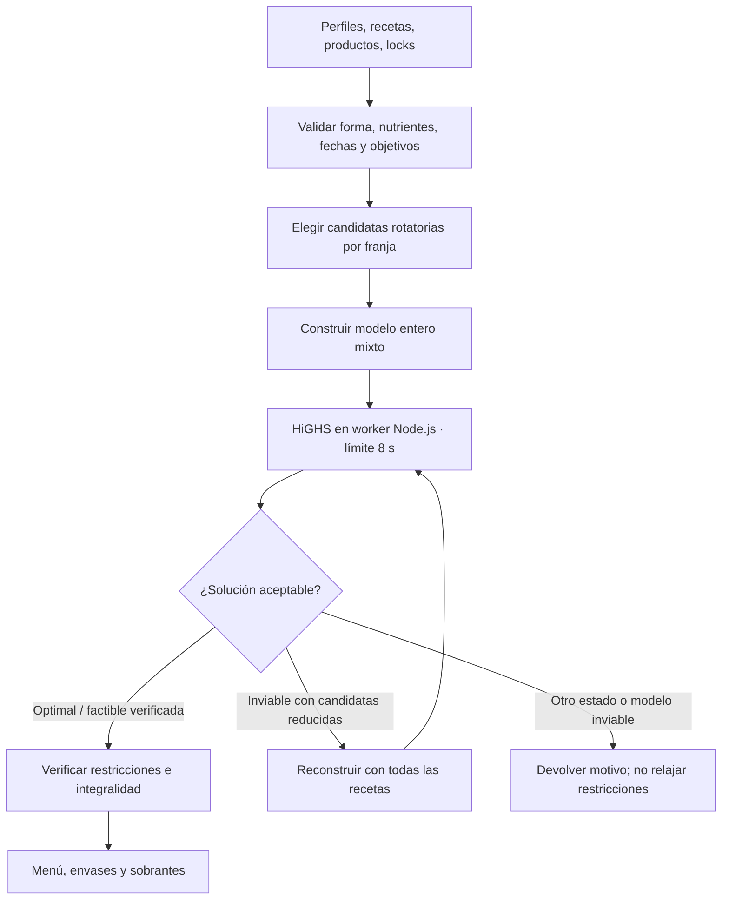

# Modelo de optimización de Mesa

## De la dieta de Stigler a la planificación actual

El problema clásico pregunta qué cantidades de alimentos escoger para minimizar el coste y satisfacer requisitos de nutrientes. Stigler publicó un análisis heurístico en 1945; versiones posteriores formularon el problema como programación lineal y resolvieron el ejemplo histórico de 77 alimentos y 9 nutrientes. Es una demostración de optimización matemática; sus alimentos, precios y requisitos históricos no son los datos que usa Mesa. Consulta la explicación de [Google OR-Tools](https://developers.google.com/optimization/lp/stigler_diet) y la revisión académica [A Review of the Use of Linear Programming to Optimize Diets](https://pmc.ncbi.nlm.nih.gov/articles/PMC6021504/).

Mesa conserva el patrón de «minimizar un objetivo sujeto a restricciones», pero las variables representan recetas aprobadas, porciones y envases durante 14 días para dos personas. El solver aplica los objetivos acordados para cada perfil; no genera recomendaciones a partir de un diagnóstico. Los resultados dependen de que recetas, precios y valores nutricionales estén introducidos correctamente.

## Variables y restricciones

Para día `d`, franja `m`, receta `r`, persona `p`, producto `i`:

- `y[d,m,r] ∈ {0,1}` indica si se sirve la receta en la franja.
- `x[d,m,r,p] ∈ Z≥0` mide medios platos; una unidad equivale a 0,5 ración.
- `b[i] ∈ Z≥0` es el número de envases comprados.
- Variables auxiliares representan exceso de repeticiones, producto sobrante y existencias que caducan.

El modelo exige exactamente una receta por franja y día. Para cada persona y día, energía y macros deben estar entre el 90 % y el 110 % del objetivo introducido. Un máximo de repeticiones, grupos semanales mínimos, nutrientes activos y fijaciones son restricciones adicionales cuando se configuran. Si están incompletos los datos nutricionales necesarios, el optimizador falla de forma explícita en vez de tratar los desconocidos como cero.

La cantidad de producto consumida proviene de los ingredientes por ración multiplicados por las porciones asignadas. La compra usa envases enteros y tiene en cuenta existencias actuales; las fechas de caducidad limitan qué existencias se cuentan como utilizables. Los envases comprados se consideran disponibles durante todo el horizonte de 14 días.

## Función objetivo implementada

El código minimiza una suma ponderada:

```text
coste de envases
+ 0,05 × valor estimado de sobrantes
+ 0,20 × valor estimado de existencias que caducan sin usar
+ 0,0001 × mg de sodio planificados
+ 0,75 × cada repetición adicional de una receta
+ 0,03 × (4 − valoración) por receta elegida
```

Los términos de sodio, repetición, sobrante y valoración son ponderaciones de la función objetivo expresadas en unidades equivalentes al coste; no son límites máximos. Por tanto, minimizar la función no implica minimizar el sodio por separado. El sodio por ración debe estar conocido para las recetas seleccionables.

## Flujo de resolución



Al haber más de tres recetas para una franja, la búsqueda inicial retiene las dos de mayor energía y completa hasta tres mediante una rotación por día. Si esa variante reducida es inviable, el cálculo se repite con el conjunto completo. El solver dispone de ocho segundos y un gap relativo objetivo del 1 %. Un resultado `Time limit reached` solo se acepta si pasa la validación posterior; se etiqueta como factible y no como óptimo probado. La aplicación no relaja automáticamente los objetivos.

## Datos: precio no es nutrición

La integración de Mercadona normaliza el identificador, nombre, precio, tamaño/unidad y procedencia cuando están disponibles. El modelo actual necesita valores nutricionales a nivel de receta por ración, y sodio explícito; nutrientes adicionales se activan según los objetivos de perfil. No se extraen ni infieren nutrientes desde las imágenes del catálogo en el flujo actual. Un precio y un peso neto no permiten deducir calorías, grasas, proteína, carbohidratos, sodio u otros micronutrientes. La composición debe capturarse desde una etiqueta/fuente fiable y vincularse a los ingredientes mediante un flujo futuro de revisión.

## Limitaciones conocidas

- Un menú factible satisface las restricciones que se han configurado; la variedad depende de sus límites y preferencias opcionales, mientras que alergias e inocuidad no son variables de este modelo.
- Los límites nutricionales y penalizaciones dependen de datos introducidos; los datos sintéticos no son aptos para orientar decisiones reales.
- El límite diario de ±10 % es una configuración de esta implementación.
- La variedad tiene penalización y límites opcionales, pero no se modelan todos los aspectos de aceptabilidad, saciedad, cultura o preparación.
- El cálculo estima una compra quincenal en una sola operación; no planifica dos compras ni la conservación real de todos los productos.
- La selección rotatoria reduce el tamaño de la primera búsqueda. El fallback busca en el conjunto completo solo ante inviabilidad, por lo que una solución reducida factible puede no ser el óptimo global.
- El balance de sodio es una penalización, no un máximo; los perfiles pueden activar otros límites estrictos usando los datos registrados en las recetas.

Para ver cómo el optimizador se conecta a la interfaz, el worker y los endpoints, consulta [Arquitectura](arquitectura.md).
